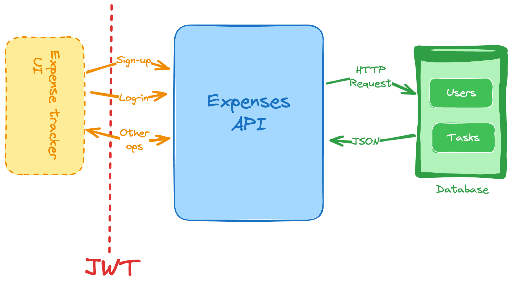

# ExpenseTracker

The API for an expense tracker application that allows users to create, read, update, and delete expenses. Users can sign up and log in to the application. Each user should have their own set of expenses.

### Features

- Sign up as a new user
- Generate and validate JWTs for handling authentication and user sessions
- List and filter the past expenses by adding the filters:
    - Past week
    - Past month
    - Last 3 months
    - Custom (by specifying a start and end date)
- Add a new expense
- Delete existing expenses
- Update existing expenses

### Constraints

- Use JWT (JSON Web Token) to protect the endpoints and to identify the requester
- Create a list of expense categories:
    - Groceries
    - Leisure
    - Electronics
    - Utilities
    - Clothing
    - Health
    - Others
    - Custom
